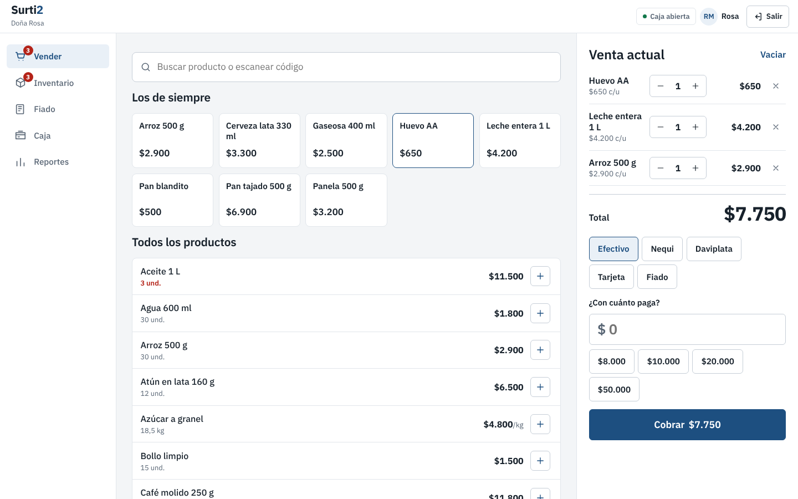
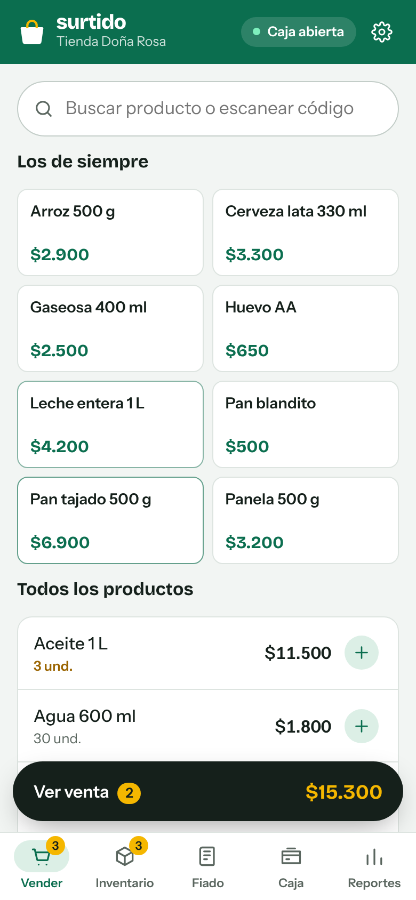
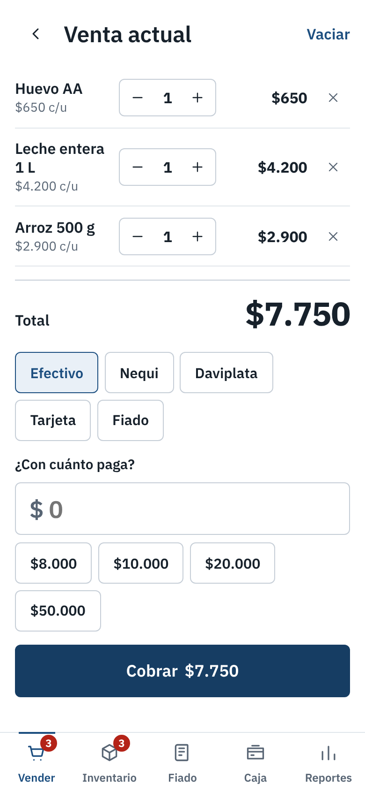
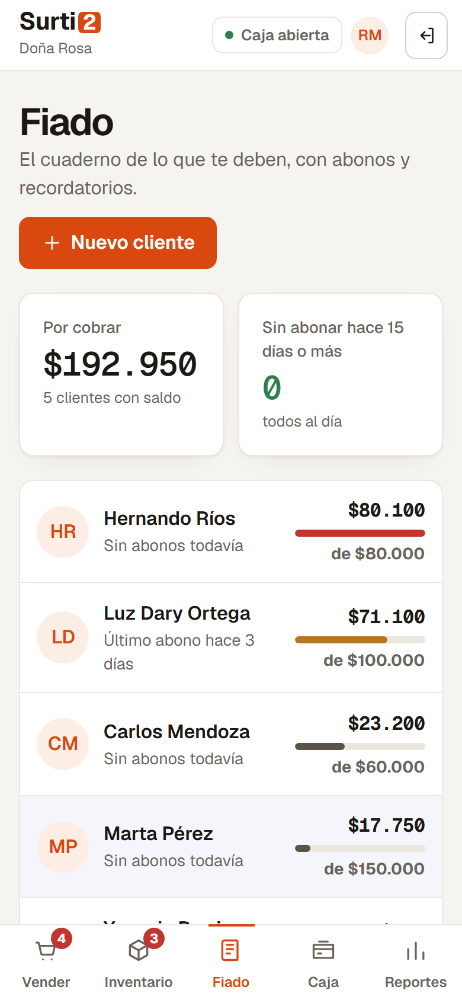

# Surtido: app de punto de venta para tiendas de barrio

Aplicación web para el tendero: registra ventas en segundos, descuenta el inventario, lleva el **fiado** de los clientes, cuadra la **caja** al final del día y muestra **reportes** de ventas y ganancia. Funciona en el celular y en el computador, y **sigue funcionando sin internet**.

El sitio tiene dos partes: la página de presentación del producto en la raíz (HTML, CSS y JavaScript sin frameworks, en `landing/`) y la app en `/app/`. Desde la presentación, **"Abrir la app"** lleva a la tienda, y **"Probar con la tienda de ejemplo"** entra sin registrarse.

**En vivo:** https://surtido-app-tan.vercel.app



| Vender en el celular | Cobro | Fiado |
| --- | --- | --- |
|  |  |  |

## Funcionalidades

**Vender**
- "Los de siempre": botones grandes para los productos que más se venden.
- Búsqueda sin tildes, por nombre, categoría o código de barras.
- Lector de códigos: un lector USB escribe el código en el buscador y presiona Enter; en Android también se puede usar la **cámara** (API nativa `BarcodeDetector`).
- Productos por peso: se venden **por valor** ("deme $2.000 de tomate") o por gramos, redondeados a $50.
- Pago en efectivo con billetes sugeridos y cálculo del cambio, Nequi, Daviplata, tarjeta o fiado.
- Aviso cuando el inventario no alcanza y cuando un cliente supera su cupo de fiado.

**Inventario**
- Precio, costo, margen, existencias y mínimo por producto.
- Entradas de mercancía y salidas por pérdida o daño.
- Productos por pedir y **pedido sugerido** listo para enviar al proveedor por WhatsApp.
- Valor del inventario a costo y a precio de venta.

**Fiado**
- El cuaderno de cada cliente: cargos, abonos y anulaciones con fecha y productos.
- Cupo por cliente y barra de uso.
- **Recordatorio de cobro por WhatsApp** con el mensaje ya redactado.

**Caja**
- Apertura con base, efectivo esperado (base + ventas y abonos en efectivo) y cierre con conteo: muestra si sobra o falta.
- Ventas del turno con opción de **anular**, que devuelve los productos al inventario y descuenta la deuda si era fiada.
- Historial de cierres.

**Reportes**
- Vendido, ganancia y venta promedio de hoy o de los últimos 7 días, con comparación frente a la semana anterior.
- Gráfico de ventas por día, formas de pago y productos más vendidos.
- Exportación a **Excel (CSV)** para el contador.

**Cuentas y roles**
- Registro de la tienda con su dueño e inicio de sesión con correo o celular y contraseña.
- Contraseñas guardadas con **PBKDF2 + sal** (Web Crypto), nunca en texto plano. La copia de seguridad no las incluye.
- Roles: el **dueño** administra todo y crea **vendedores**; el vendedor vende, fía y maneja caja, pero no ve reportes, no edita precios ni anula ventas.
- Cada venta queda a nombre de quien la registró, con reporte de ventas por vendedor.

**Tienda en la nube (Supabase)**
- El dueño crea la tienda con su correo (con confirmación por correo y recuperación de contraseña). Agrega a sus vendedores desde Ajustes y cada uno entra con su celular o correo. Todos ven la misma tienda en tiempo casi real.
- **Sigue funcionando sin internet:** cada cambio queda en una cola guardada en el equipo y sube solo cuando vuelve la conexión. En la barra se ve cuántos cambios faltan por subir.
- **Dos celulares vendiendo al tiempo no se pisan:** las existencias nunca se sobrescriben, se suman o restan en la base (`ajustar_stock`), así se descuentan las dos ventas.
- **Permisos en la base, no solo en la pantalla:** políticas RLS por tienda y un trigger que solo deja al dueño cambiar precios. El vendedor no puede anular ventas ni registrar ventas a nombre de otro, aunque modifique el código del navegador.
- Crear vendedores y cambiarles la contraseña lo hace una función del servidor (`supabase/functions/vendedores`), porque necesita la llave de servicio, que nunca va al navegador.
- Sin Supabase configurado, la app funciona como antes: todo en el navegador. La tienda de ejemplo nunca necesita cuenta.

**Ajustes**
- Copia de seguridad descargable y restauración.
- Tienda de ejemplo con una semana de ventas para explorar la app, o empezar en blanco.

## Stack

| Área | Herramienta |
| --- | --- |
| Interfaz | React 19 + TypeScript estricto |
| Estado | **Redux Toolkit** (slices, `createEntityAdapter`, `createSelector`, thunks) + React Redux |
| Rutas | React Router 7 (`HashRouter`, funciona en cualquier hosting estático) |
| Build | Vite 8 |
| Sin conexión | PWA con service worker (vite-plugin-pwa) + estado persistido en `localStorage` |
| Nube | Supabase: Auth (PKCE), PostgreSQL con RLS, funciones `plpgsql` y una Edge Function en Deno |
| Sincronización | Cola de cambios hecha a mano: diferencias del estado de Redux → operaciones, compactadas y enviadas en orden; descarga incremental por `actualizado_en` |
| Pruebas | Vitest + Testing Library (54 pruebas, con un Supabase falso en memoria y dos "equipos" sincronizando a la vez) |
| Calidad | oxlint, `tsc`, GitHub Actions |

## Arquitectura del estado

```
src/
├── app/
│   ├── store.ts          # configureStore, tipos RootState / AppDispatch / AppThunk
│   ├── hooks.ts          # useAppDispatch / useAppSelector tipados
│   └── persistence.ts    # guardado en localStorage, copia de seguridad
├── features/
│   ├── auth/             # usuarios, sesión, roles y permisos (thunks async con Web Crypto)
│   ├── products/         # entityAdapter, stock, favoritos, selectores de inventario
│   ├── cart/             # venta en curso, forma de pago, cambio
│   ├── sales/            # acciones compartidas, checkout (thunk), anulación, reportes
│   ├── customers/        # clientes + libro de movimientos del fiado, saldos
│   ├── cash/             # turnos de caja y cuadre
│   ├── settings/
│   └── nube/             # modo local o nube, cambios pendientes, en línea o no
├── nube/                 # Supabase: cliente, cuentas, cola de cambios (cambios.ts) y sincronización (sync.ts)
├── pages/                # Acceso (entrar/registro), Vender, Inventario, Fiado, Cliente, Caja, Reportes, Ajustes
├── components/           # Layout, Modal (<dialog> nativo), Toast, Scanner, UI
├── lib/                  # dinero, fechas en hora de Colombia, WhatsApp, CSV
└── data/seed.ts          # tienda de ejemplo generada a través de los mismos reducers
supabase/
├── migrations/           # tablas, políticas RLS, triggers y funciones de Postgres
└── functions/vendedores/ # Edge Function: el dueño crea, cambia y quita vendedores
```

Decisiones que vale la pena explicar en una entrevista:

- **Una venta es una sola acción** (`sales/recorded`) que escuchan cuatro slices con `extraReducers`: inventario descuenta, ventas guarda, fiado suma la deuda y el carrito se vacía. Ningún slice conoce a los otros y la operación es atómica.
- **La venta guarda una copia del precio y el costo** del momento. Si mañana sube la leche, los reportes de ayer no cambian.
- **La nube no cambió ni una pantalla ni un reducer.** Un middleware compara el estado antes y después de cada acción y lo convierte en operaciones para la base (`src/nube/cambios.ts`). Las existencias viajan como suma o resta, no como valor final, para que dos equipos vendiendo a la vez no se pisen.
- **El saldo del fiado no se guarda, se calcula** a partir del libro de movimientos con un selector memoizado. Así nunca se descuadra.
- **El checkout es un thunk que devuelve un resultado tipado** (`ok` o el motivo del error), en vez de lanzar excepciones. La interfaz decide qué mostrar.
- **Los datos de ejemplo se generan despachando acciones reales** con una semilla fija: si el modelo cambia, el ejemplo sigue siendo coherente.
- **Rutas protegidas**: sin sesión, la app redirige a entrar o a crear la tienda; las pantallas del dueño validan el permiso, no solo esconden el botón.
- Dinero en enteros de pesos. Lo vendido por peso se redondea a $50 porque en Colombia casi no circulan monedas menores.

## Cómo correrlo

Requiere Node.js 20 o superior. En Windows con PowerShell usa `npm.cmd` si `npm` da error de scripts deshabilitados.

```bash
npm install
npm run dev       # http://localhost:5173
npm test
npm run build     # genera dist/: la presentación en la raíz y la app en dist/app/
```

La primera vez pide **crear la tienda**: nombre, tu usuario (correo o celular) y una contraseña. Ahí eliges si empezar con la tienda de ejemplo o en blanco. Para mirarla sin registrarse está el botón **"Probar con la tienda de ejemplo"**.

Para generar la versión portátil (un solo `index.html` que abre con doble clic):

```bash
npm run build:portable   # escribe en portable/index.html
```

## Conectarla a Supabase

1. Crea un proyecto en [supabase.com](https://supabase.com) y corre `supabase/migrations/20261021000000_surtido.sql` en el SQL Editor.
2. Despliega la función de vendedores: `supabase functions deploy vendedores`.
3. En Authentication → URL Configuration agrega la dirección de la app (por ejemplo `https://surtido-app-tan.vercel.app/app/`) como Site URL y en Redirect URLs.
4. Copia `.env.example` como `.env.local` (o crea las mismas variables en Vercel) con la URL y la llave anon del proyecto.

## Publicarla

Está publicada en Vercel, que vuelve a publicar sola con cada cambio en `main`. `npm run build` genera la carpeta `dist/`, que también se puede subir tal cual a Netlify o GitHub Pages. Desde el celular, el navegador ofrece **"Agregar a la pantalla de inicio"** y queda como una app más.

## Próximos pasos

- Facturación electrónica DIAN para el plan Minimercado.
- Recibo por WhatsApp al cliente.

---

Proyecto de portafolio de Orlando Castillo. La tienda, los clientes y las ventas de ejemplo son ficticios.
